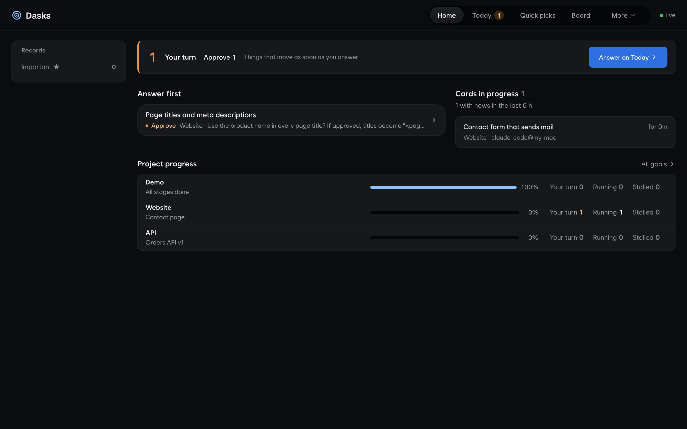
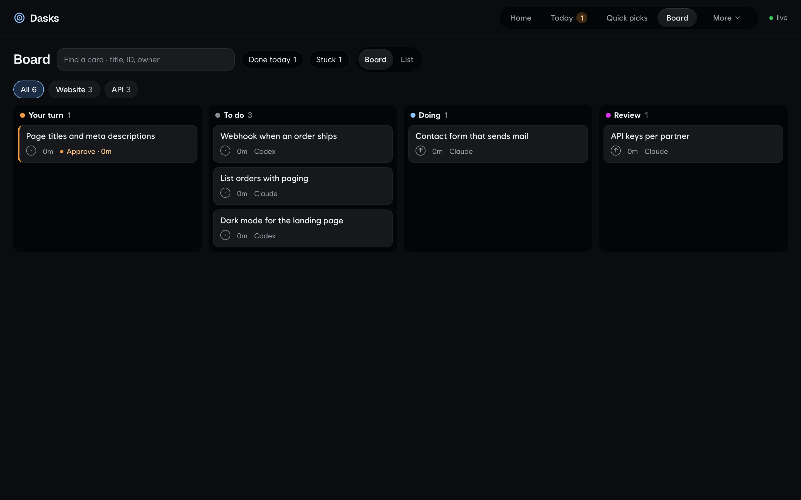
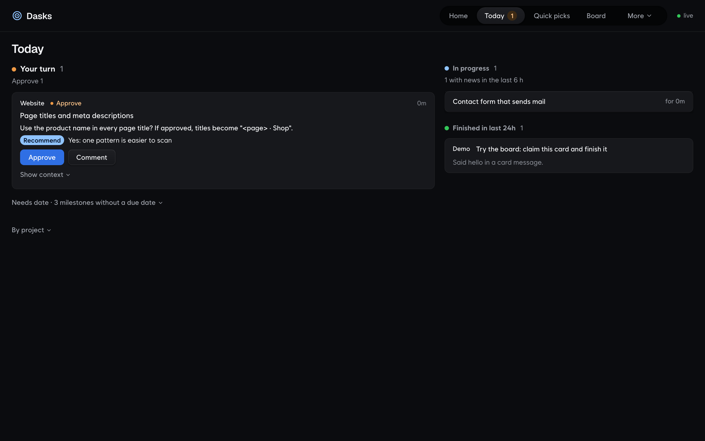
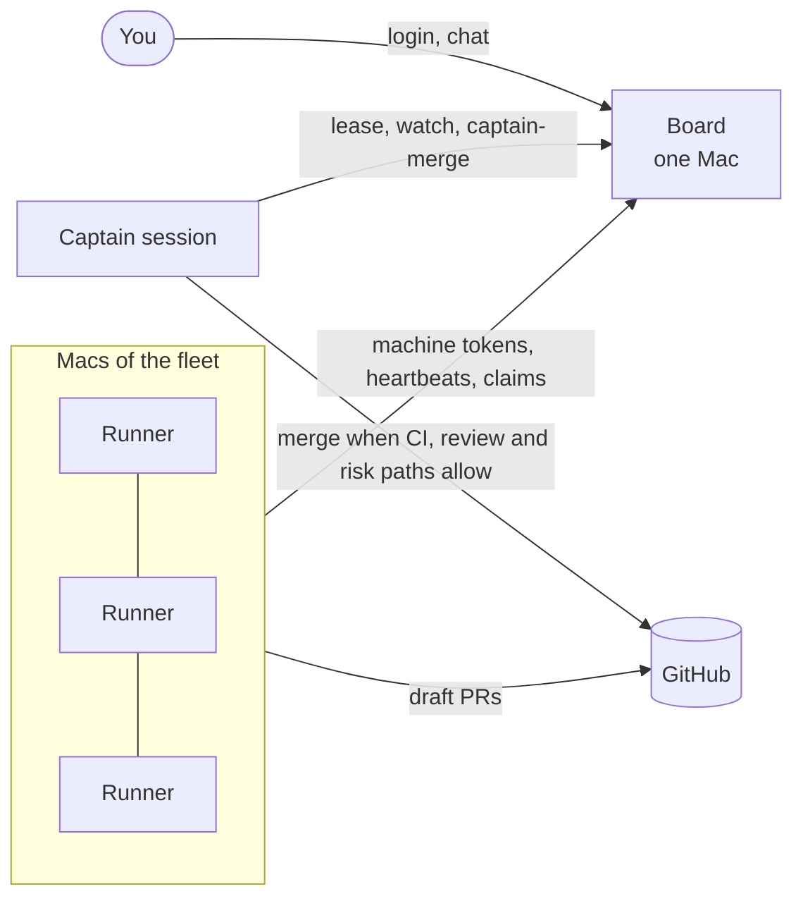
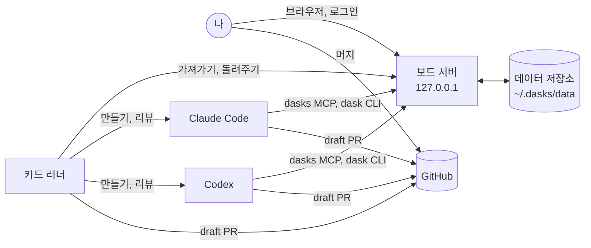

<picture>
  <source media="(prefers-color-scheme: dark)" srcset="docs/assets/banner-dark.svg">
  
</picture>

[](https://github.com/drake-agent/dasks-kit/actions/workflows/ci.yml)
[](LICENSE)
[](FOR_AGENTS.md)
[](FOR_AGENTS.md)
[](#설치)

[English](README.md) · **한국어**

내 Mac에서 나와 코딩 에이전트가 함께 쓰는 작업 보드예요.

**카드를 쓰면 Claude Code나 Codex가 가져가서 draft PR로 돌려줘요. 머지는 내가 정해요.** 보드의 데이터는 YAML과
Markdown 파일로 된 평범한 git 저장소라서, 모든 변경이 읽고 비교하고 되돌릴 수 있는 커밋으로 남아요. 기본 설정에서는
`127.0.0.1`에서만 동작하고, 플릿으로 보드를 내 네트워크에 열 때만 다른 Mac에서 닿아요.

[설치](#설치) · [화면](#화면) · [들어 있는 것](#들어-있는-것) · [쓰는 법](#쓰는-법) · [러너](#러너) ·
[구조](#구조) · [삭제](#삭제) · [에이전트용 안내](#에이전트용-안내)

## 설치

macOS, Node 22.18 이상, git, python3가 필요해요. 푸시하려면 `gitleaks`도 있어야 해요. 없으면 설치할 때
`brew install gitleaks`를 권해 드려요.

**방법 1: 에이전트에게 맡기기.** Claude Code(또는 Codex)에 이 문장을 붙여 넣으세요.

```text
https://github.com/drake-agent/dasks-kit 의 FOR_AGENTS.md를 따라 Dasks를 설치하고, 첫 카드를 보여줘.
```

**방법 2: 직접 설치하기.**

```bash
git clone https://github.com/drake-agent/dasks-kit.git ~/dasks-kit
cd ~/dasks-kit
./install.sh
open http://127.0.0.1:4747
```

설치할 때 보드 로그인용 암호 문구(12자 이상)를 물어봐요. 다시 실행하면 고치거나 업데이트할 수 있어요.

| 옵션 | 하는 일 |
|---|---|
| `--port N` | 보드를 N번 포트에서 열어요(기본 4747). 모든 클라이언트가 이 포트를 따라가요 |
| `--passphrase-file F` | 묻는 대신 F 파일의 첫 줄을 암호 문구로 써요 |
| `--with-runner` | 카드 러너도 설치해요([러너](#러너) 참고) |
| `--with-merge-gate` | Claude Code 훅을 추가해요. 내가 그 PR의 head를 승인해야 `gh pr merge`가 실행돼요 |
| `--no-launchd` | LaunchAgent를 설치하지 않아요. 보드는 직접 켜야 해요 |
| `--no-claude-mcp` / `--no-codex-mcp` | 해당 도구의 MCP 등록을 건너뛰어요 |
| `--dry-run` | 바뀔 내용만 보여 주고 아무것도 바꾸지 않아요 |

설치가 만든 것은 모두 `~/.dasks/install.json`에 적혀요. 설치가 만들지 않은 파일, 링크, 스킬, MCP 항목은 절대
덮어쓰지 않아요.

## 화면







## 들어 있는 것

| 구성 | 설명 |
|---|---|
| 보드 서버와 웹 화면 | `http://127.0.0.1:4747`: 홈, 오늘(내 차례), 보드, 목표, 프로젝트별 페이지, 결정, 마지막으로 본 뒤 끝난 카드 한 줄, 하루 요약, 리뷰 정리 화면([docs/api.md](docs/api.md#review-triage)) |
| `dasks` MCP | Claude Code와 Codex용 도구 35개: 카드 조회·생성·가져가기·끝내기, 스펙, 메시지, 아이디어, 교훈, 프로젝트 프로필, 하루 요약 |
| `dask` CLI | 저장소 안에서 쓰는 카드 흐름: `ready`, `begin`, `submit`, `release`, `msg`, `runner status` |
| `dasks` CLI(별칭 `gb`) | 어느 셸에서나 보드를 바로 읽고 써요. 프로젝트별 프로필(되는 것, 빠진 것)도 포함 |
| 스킬 | `dasks`(에이전트가 따르는 카드 규칙), `review-loop`(교차 모델 리뷰), `captain`. 두 도구 모두에 설치돼요 |
| 카드 러너 | 선택: 내가 없는 동안 준비된 카드를 만들고 draft PR을 열어요([docs/runner.md](docs/runner.md)) |
| 머지 게이트 | 선택 훅: 내가 그 head를 승인해야 에이전트의 머지가 실행돼요 |
| 화면 언어 | 영어(기본)와 한국어. 위쪽 막대에서 바꿀 수 있어요 |

## 쓰는 법

에이전트에게 말로 하면 돼요. MCP가 등록되면 Claude Code와 Codex 모두에서 이렇게 쓸 수 있어요.

| 이렇게 말하면 | 이렇게 돼요 |
|---|---|
| "Dasks 카드 목록 보여줘" / "List my Dasks cards" | 에이전트가 `list_tasks`를 불러 프로젝트와 상태별로 정리해요 |
| "web에 카드 만들어줘: 메일 보내는 문의 폼" / "Make a card in web: a contact form that sends mail" | 제목, 마일스톤, 완료 기준을 갖춘 새 카드가 생겨요 |
| "demo.t-hello 작업해줘" / "Work demo.t-hello" | 카드를 가져가 `human/demo.t-hello` 브랜치에서 작업하고, draft PR을 열고, 카드를 리뷰로 옮겨요 |
| "내가 결정할 거 뭐 있어?" / "What waits on me?" | 리뷰 중이거나 나를 기다리는 카드를 무엇·왜·할 일·추천과 함께 보여 줘요 |
| "web.t-form PR을 Codex가 리뷰하게 해줘" / "Have Codex review the PR for web.t-form" | 심각도별 지적이 담긴 교차 모델 리뷰를 받아요 |
| "다음 web 카드에 남길 교훈 적어줘" / "Leave a lesson for the next web card" | 프로젝트 페이지에서 내가 확정할 교훈 제안이 생겨요 |

셸에서는 이렇게 해요.

```bash
dasks new web "Add a contact form" --body $'## Done criteria\n- the form sends a test mail'
dask ready
dask begin web.t-form --tool claude
dask submit web.t-form --summary "Contact form with mail sending"
```

프로젝트는 `~/.dasks/data/config.json`에 있어요. 여기에 추가하고, `data/goals/demo.yaml`을 복사해 목표 파일을 만든
뒤, 커밋하고 보드를 다시 켜 주세요.

```bash
launchctl kickstart -k gui/$(id -u)/dev.dasks.server
```

에이전트가 지키는 규칙이에요.

| 규칙 | 이유 |
|---|---|
| 카드를 리뷰나 나에게 넘길 때는 `## Context` 블록(What, Why, Do, Recommend, After)이 있어야 해요 | 다른 걸 열어 보지 않고도 바로 결정할 수 있어요 |
| 승인은 보드에 로그인한 나만 할 수 있어요 | 카드 메시지나 다른 에이전트의 말은 승인이 아니에요 |
| `dask submit`과 러너는 gitleaks 검사 없이는 푸시하지 않아요 | 비밀 값이 브랜치에 올라가지 않아요 |
| PR은 draft로 열리고, 머지는 내가 해요 | 머지 게이트가 에이전트를 막아 줘요 |
| 에이전트가 쓰려면 `~/.dasks/client.json`의 토큰이 있어야 해요 | 다른 계정, 웹 페이지, 엉뚱한 스크립트는 쓸 수 없어요([docs/auth.md](docs/auth.md)) |

## 러너

`dasks-runner`는 내가 없는 동안 준비된 카드를 처리해요. 카드를 가져가서 worktree에서 `claude -p`나 `codex exec`로
만들고, 다른 모델에게 리뷰를 받고, P0/P1 지적이 있으면 한 번 고치게 하고, gitleaks로 검사한 뒤 `dasks/<card>`를
푸시하고 **draft** PR을 열어서 카드를 리뷰 상태로 돌려줘요. 머지는 절대 하지 않아요.
시간 한도가 지나도 아직 쓰고 있는 실행은 계속 두고, 조용해진 실행은 멈춰요(최대 12시간). 열린 PR이 10개를 넘는
저장소에는 PR을 머지하거나 닫을 때까지 새 카드를 시작하지 않아요. 내가 밀어 둔 카드 다음으로 버그 수정 카드를 먼저
시작해요. 플릿의 맥에서는 카드 사이에 키트를 최신으로 유지해요.

```bash
./install.sh --with-runner
dask runner status
```

켜기 전에 [docs/runner.md](docs/runner.md)를 꼭 읽어 주세요. 에이전트가 아무도 보지 않는 상태에서 내 로그인으로
카드의 worktree 안에서 명령을 실행해요.

## 스펙

러너는 스펙이 준비된(ready) 카드만 만들고, 그 스펙도 Dasks가 써요. 만들 카드가 없으면 러너가 프로젝트 기본 브랜치의
읽기 전용 사본을 보고 한 하네스로 스펙 초안을 쓰고, 다른 하네스가 공격적으로 리뷰하고 고쳐요(전체 리뷰 두 번, 그 뒤 고친 부분만 보는 좁은 리뷰는 최대 한 번).
결과는 ready이거나, 지적 사항을 카드 메모로 남긴 draft예요. 내 세션에서는 `dask spec <card>`로 같은 과정을 돌려요.
모든 스펙에는 끝나는 지점(`done_when`, 그리고 `done_at: pr` 또는 `live`)이 있어요. `live` 카드는 머지 후에 누군가
`dask verify`로 확인을 기록할 때까지 기다려요. 자세한 내용은 [docs/specs.md](docs/specs.md)에 있어요.

## 캡틴과 플릿

선택 기능이에요. 팀이나 Mac 여러 대에서 보드 하나를 함께 쓰고, 오래 떠 있는 **캡틴** 세션 하나가 일을 이끌어요.



- **플릿** ([docs/fleet.md](docs/fleet.md)): `./install.sh --listen <주소> --tls-cert <pem> --tls-key <key>`로
  보드를 내 사설 네트워크에 HTTPS로 열고, `dasks machine add <이름>`으로 Mac마다 토큰을 따로 발급하고, 다른 Mac에서는
  `./install.sh --join <URL> --token-file <파일>`로 설치해요. 러너는 하트비트를 보내고(`dasks fleet`), 소식이 끊긴
  러너의 카드는 보드가 돌려놓아요.
- **캡틴** ([docs/captain.md](docs/captain.md)): `dasks-captain`이 보드의 캡틴 리스(한 번에 하나)를 잡고 캡틴 스킬로
  Claude Code나 Codex, 다른 CLI를 띄워요. `dasks-captain-watch`로 보드를 지켜보며 러너에게 일을 대고, Fleet 화면의
  캡틴 채팅에 답하고, `dask captain-merge`로 머지해요. 이 명령은 PR 헤드의 CI가 초록이고, 그 헤드에 대한 깨끗한
  교차 모델 리뷰가 기록돼 있고, 저장소의 `risk-paths.txt`에 걸리는 파일이 없을 때만 머지해요. 나머지는 모두 사람
  몫이에요. 채팅은 아무것도 승인하지 않아요.

## 구조



| 부분 | 위치 |
|---|---|
| 서버 | `src/server.ts`, `127.0.0.1`에만 열려요. 로그는 `~/.dasks/server.log` |
| 데이터 | `~/.dasks/data`: `config.json`, `data/`(카드, 목표, 스펙, 활동 기록), `run/`(커밋하지 않아요) |
| 연결 정보와 토큰 | `~/.dasks/client.json`(권한 600). 모든 클라이언트가 읽어요 |
| HTTP API | [docs/api.md](docs/api.md) |
| 카드, 스펙, touches, 메시지 | [docs/cards.md](docs/cards.md) |
| 로그인과 토큰 | [docs/auth.md](docs/auth.md) |

테스트는 `npm ci && npm test`로 돌려요.

## 삭제

```bash
./uninstall.sh          # 러너를 먼저 멈춰 카드를 돌려준 뒤 보드를 멈추고, 설치가 만든 것만 지워요
./uninstall.sh --purge  # ~/.dasks(보드 데이터, 암호 문구, 토큰)까지 지워요
```

## 에이전트용 안내

설치, 확인, 첫 카드까지의 정확한 단계는 [FOR_AGENTS.md](FOR_AGENTS.md)에 있어요. 카드 작업은 `dasks` 스킬
([skills/dasks/SKILL.md](skills/dasks/SKILL.md))을 따라요.

## 라이선스

[MIT](LICENSE). 함께 들어 있는 글꼴은 SIL Open Font License를 따라요(`public/ds/fonts`).
