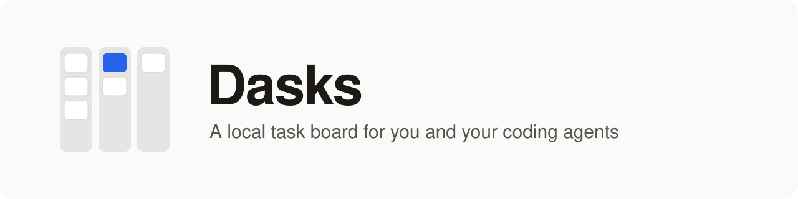
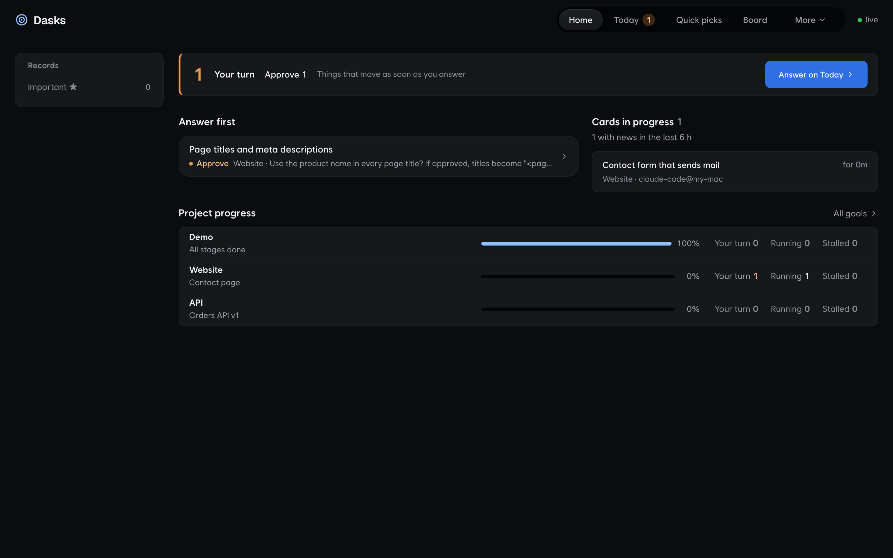
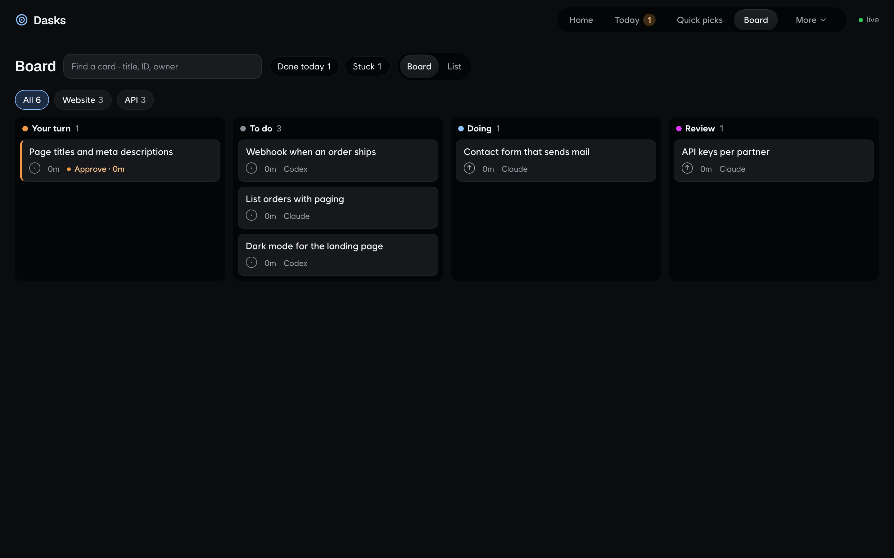
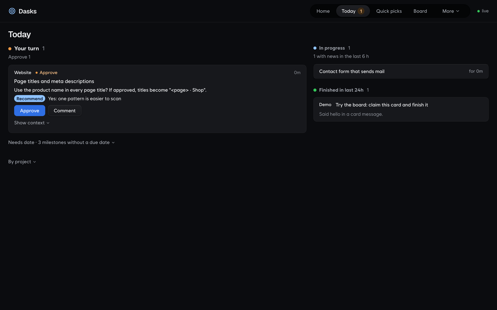
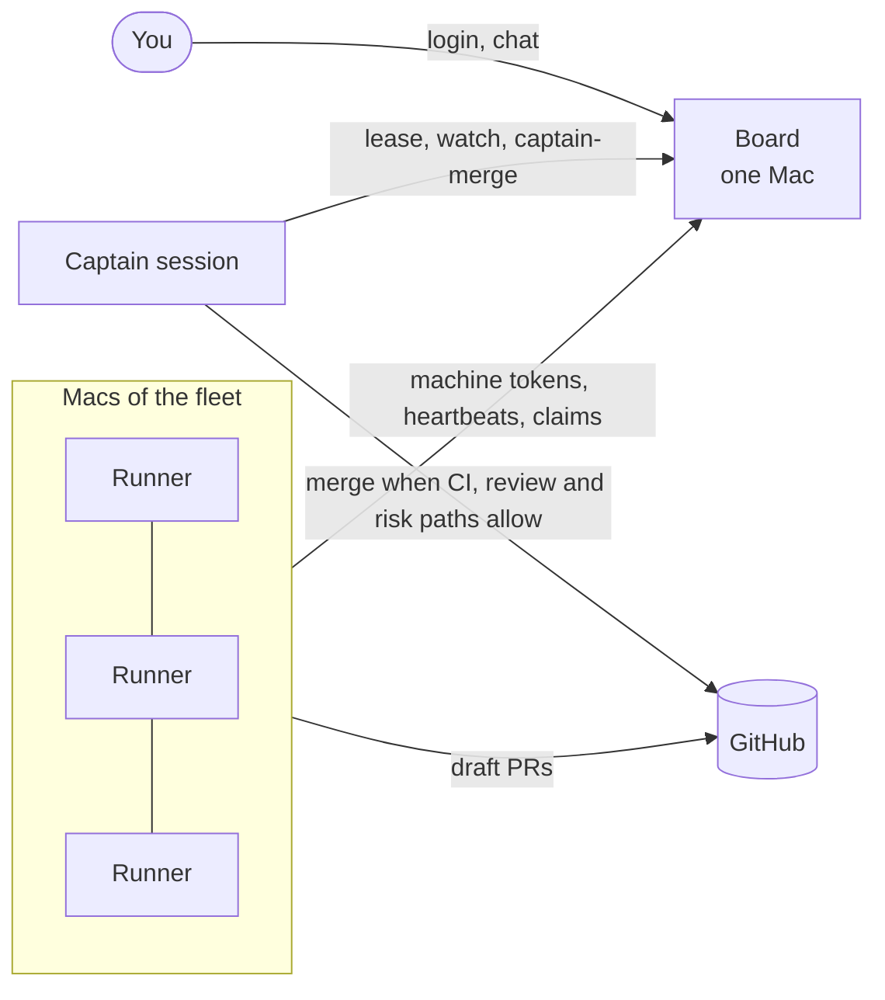
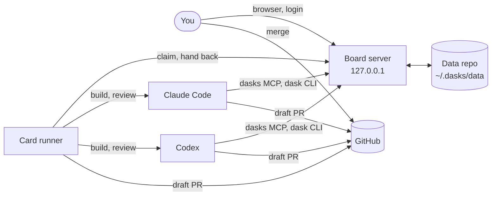

<picture>
  <source media="(prefers-color-scheme: dark)" srcset="docs/assets/banner-dark.svg">
  
</picture>

[](https://github.com/drake-agent/dasks-kit/actions/workflows/ci.yml)
[](LICENSE)
[](FOR_AGENTS.md)
[](FOR_AGENTS.md)
[](#install)

**English** · [한국어](README.ko.md)

A task board on your Mac that you and your coding agents share.

**Write the card, let Claude Code or Codex claim it, get a draft PR back. You decide what merges.** The board's
database is a plain git repo of YAML and Markdown files, so every change is a commit you can read, diff and revert.
Nothing listens beyond `127.0.0.1` unless you put the board on your own network for a [fleet](#captain-and-fleet).

[Install](#install) · [See it](#see-it) · [What you get](#what-you-get) · [Use it](#use-it) · [Runner](#runner) ·
[Captain and fleet](#captain-and-fleet) · [How it works](#how-it-works) · [Uninstall](#uninstall) ·
[For agents](#for-agents)

## Install

Needs macOS, a Node release with its security fixes (22.23.4+, 24.22.1+ or 26.12.1+), git and python3. `gitleaks` is needed to push (the installer offers `brew install gitleaks`).

**Path 1: let your agent do it.** Paste this into Claude Code (or Codex):

```text
Install Dasks from https://github.com/drake-agent/dasks-kit by following its FOR_AGENTS.md, then show me my first card.
```

**Path 2: by hand.**

```bash
git clone https://github.com/drake-agent/dasks-kit.git ~/dasks-kit
cd ~/dasks-kit
./install.sh
open http://127.0.0.1:4747
```

The installer asks for a board login passphrase (12+ characters). Run it again any time to repair or update.

| Option | What it does |
|---|---|
| `--port N` | serve the board on port N (default 4747); every client follows it |
| `--passphrase-file F` | read the passphrase from the first line of F instead of asking |
| `--with-runner` | also install the card runner (see [Runner](#runner)) |
| `--with-merge-gate` | add a Claude Code hook: `gh pr merge` runs only after you approve that PR head |
| `--listen ADDR` | also serve the board on this address, for other Macs ([docs/fleet.md](docs/fleet.md)) |
| `--tls-cert F --tls-key F [--ca-file F]` | serve HTTPS (required with a `--listen` address beyond this Mac; [docs/fleet.md](docs/fleet.md#tls)) |
| `--join URL --token-file F [--ca-file F]` | this Mac joins a board on another Mac: clients, skills and runner only ([docs/fleet.md](docs/fleet.md)) |
| `--no-launchd` | skip the LaunchAgent; start the board yourself |
| `--no-claude-mcp` / `--no-codex-mcp` | skip the MCP registration for that tool |
| `--dry-run` | print what would change, change nothing |

Everything it makes is listed in `~/.dasks/install.json`. It never replaces a file, link, skill or MCP entry it did not
make.

## See it







## What you get

| Piece | What it is |
|---|---|
| Board server and web UI | `http://127.0.0.1:4747`: Home, Today (what waits on you), Board, Goals, a page per project, decisions, a line of cards finished since you last looked, a daily summary and a review triage page ([docs/api.md](docs/api.md#review-triage)) |
| `dasks` MCP | 35 tools for Claude Code and Codex: list, create, claim and finish cards; specs; messages; ideas; lessons; project profiles; the daily summary |
| `dask` CLI | the card workflow inside a repo: `ready`, `begin`, `submit`, `release`, `msg`, `runner status` |
| `dasks` CLI (alias `gb`) | raw board reads and writes from any shell, including each project's profile (what works, what is missing) |
| Skills | `dasks` (the card protocol agents follow), `review-loop` (cross-model review) and `captain`, for both tools |
| Card runner | optional: builds ready cards while you are away and opens draft PRs ([docs/runner.md](docs/runner.md)) |
| CI runners | optional: `dasks-ci` runs your repos' GitHub Actions jobs on your own Macs, sized to each Mac, with a cap on jobs at once ([docs/ci-runners.md](docs/ci-runners.md)) |
| Merge gate | optional hook: an agent's merge runs only after you approve that exact head |
| Captain and fleet | optional: one board for many Macs, and a captain session that steers them ([below](#captain-and-fleet)) |
| UI languages | English (default) and Korean, switched in the top bar |

## Use it

Talk to your agent. These work in Claude Code and Codex once the MCP is registered:

| You say | What happens |
|---|---|
| "List my Dasks cards" / "Dasks 카드 목록 보여줘" | the agent calls `list_tasks` and sums up cards by project and status |
| "Make a card in web: a contact form that sends mail" / "web에 카드 만들어줘: 메일 보내는 문의 폼" | a new card with a title, milestone and done criteria |
| "Work demo.t-hello" / "demo.t-hello 작업해줘" | the agent claims it, branches `human/demo.t-hello`, does the work, opens a draft PR and moves the card to review |
| "What waits on me?" / "내가 결정할 거 뭐 있어?" | cards in review or blocked on you, each with What, Why, Do and Recommend |
| "Have Codex review the PR for web.t-form" / "web.t-form PR을 Codex가 리뷰하게 해줘" | a cross-model review: findings with a repro or a high-risk tag block, the rest are follow-ups |
| "Leave a lesson for the next web card" / "다음 web 카드에 남길 교훈 적어줘" | a lesson proposal you confirm on the project page |

From a shell:

```bash
dasks new web "Add a contact form" --body $'## Done criteria\n- the form sends a test mail'
dask ready
dask begin web.t-form --tool claude
dask submit web.t-form --summary "Contact form with mail sending"
```

Projects live in `~/.dasks/data/config.json`. Add one there, copy `data/goals/demo.yaml` for its goal file, commit, and
restart the board:

```bash
launchctl kickstart -k gui/$(id -u)/dev.dasks.server
```

The rules agents follow:

| Rule | Why |
|---|---|
| Moving a card to review or to you needs a `## Context` block: What, Why, Do, Recommend, After | you can decide without opening anything else |
| Only you approve, logged in on the board | card messages and other agents never count as approval |
| `dask submit` and the runner refuse to push without a gitleaks scan | secrets do not reach a branch |
| PRs are drafts; merging is yours | the merge gate holds agents to it |
| Agent writes need the token in `~/.dasks/client.json` | other accounts, web pages and stray scripts cannot write ([docs/auth.md](docs/auth.md)) |

## Runner

`dasks-runner` works ready cards while you are away. It claims a card, builds it in a worktree with `claude -p` or
`codex exec`, has the other model review it (at most 2 passes, with one fix pass between them; only a finding with a repro, or one
tagged security, data-loss, approval or money, blocks), scans with gitleaks, pushes `dasks/<card>`, opens a **draft** PR
and hands the card back to you in review. Not clean after pass 2: the PR stays a draft, the card is blocked and you are
told. It never merges.
A run that is still writing is kept past its time limit; a quiet one is stopped (12 h at most). A repo with more than
10 open PRs gets no new cards until you merge or close some. Bug fixes start before other cards, after the ones you
pushed. On a fleet Mac the runner keeps its kit current between cards.

```bash
./install.sh --with-runner
dask runner status
```

Read [docs/runner.md](docs/runner.md) before you turn it on: the agent runs commands in the card's worktree with nobody
watching, using your logins.

## Specs

The runner builds only cards with a ready spec, and Dasks writes those specs too. With nothing ready to build, the
runner drafts a spec with one harness from a read-only copy of the project's default branch, has the other harness
attack it and revises (two full review passes, then at most one narrow one); the spec ends ready, or draft with the findings as a card note. From your
own session: `dask spec <card>`. Every spec says where its card ends (`done_when`, and `done_at: pr` or `live`); a
`live` card waits after the merge until someone records a check with `dask verify`. See [docs/specs.md](docs/specs.md).

## Secrets (optional)

`dasks-secret` keeps API keys for your agents in your login Keychain. You type a value once into a native masked window;
an agent runs `dasks-secret run --labels maps-key -- node scripts/geocode.js`, you approve that run with Touch ID, and
the command gets `MAPS_KEY` in its environment. The value never enters the chat. Each label lists the agents allowed to
use it, and agents cannot run shells, `env`, inline scripts or network tools with secrets. The runner does not start a
card whose `secrets:` are not ready; it tells you the commands to run.

```bash
./install.sh --with-secrets              # builds it with swift (Xcode Command Line Tools)
dasks-secret store --label maps-key      # you, once
dasks-secret allow --label maps-key --agent claude-code
dask secrets <card>                      # what a card still needs
```

A speed bump, not a sandbox: an approved command can still leak its environment. Read [docs/secrets.md](docs/secrets.md).

## Captain and fleet

Optional, for a team or for several Macs: one board, runners on many Macs, and one long-lived **captain** session that
steers them.



- **Fleet** ([docs/fleet.md](docs/fleet.md)): `./install.sh --listen <addr> --tls-cert <pem> --tls-key <key>` puts
  the board on your private network over HTTPS; `dasks machine add <name>` issues each Mac its own token;
  `./install.sh --join <url> --token-file <f>` sets up another Mac. Runners send heartbeats (`dasks fleet`); the board
  gives back the cards of a runner that went quiet.
- **Captain** ([docs/captain.md](docs/captain.md)): `dasks-captain` takes the board's captain lease (one at a time) and
  starts Claude Code, Codex or another CLI with the captain skill. It watches the board with `dasks-captain-watch`, feeds
  the runners, answers you in the captain chat on the Fleet page and merges with `dask captain-merge`, which merges only
  when CI is green on the PR head, a clean cross-model review is recorded for that head and no file in the repo's
  `risk-paths.txt` changed. Everything else stays with you. Chat never approves anything.
- **Merging stays yours by default.** One Mac account can write as Claude and as Codex alike, so the board cannot prove
  which model wrote a review. Unless you set `captain.auto_merge: true`, a card that passes every check comes to you as
  "ready to merge" and the captain merges it after you approve that exact head; with auto merge on, the review must come
  from another Mac than the builder's (`captain.same_machine_review` relaxes that).

## How it works



| Part | Where |
|---|---|
| Server | `src/server.ts`, binds `127.0.0.1` (plus `server.listen` for a fleet); log in `~/.dasks/server.log` |
| Data | `~/.dasks/data`: `config.json`, `data/` (cards, goals, specs, activity), `run/` (not committed) |
| Connection and token | `~/.dasks/client.json` (mode 600), read by every client |
| HTTP API | [docs/api.md](docs/api.md) |
| Cards, specs, touches, messages | [docs/cards.md](docs/cards.md) |
| Build one version at a time | [docs/versions.md](docs/versions.md) |
| Login and tokens | [docs/auth.md](docs/auth.md) |
| Fleet and captain | [docs/fleet.md](docs/fleet.md), [docs/captain.md](docs/captain.md) |
| Upgrade, backup to a remote, restore, roll back | [docs/upgrade.md](docs/upgrade.md) |

Run the tests with `npm ci && npm test`.

## Uninstall

```bash
./uninstall.sh          # stops the runner (cards handed back), then the board; removes what install.sh made
./uninstall.sh --purge  # also deletes ~/.dasks: board data, passphrase, token
```

## For agents

[FOR_AGENTS.md](FOR_AGENTS.md) has the exact install, check and first-card steps. Working a card follows the `dasks`
skill ([skills/dasks/SKILL.md](skills/dasks/SKILL.md)).

## License

[MIT](LICENSE). The bundled fonts are under the SIL Open Font License (`public/ds/fonts`).
