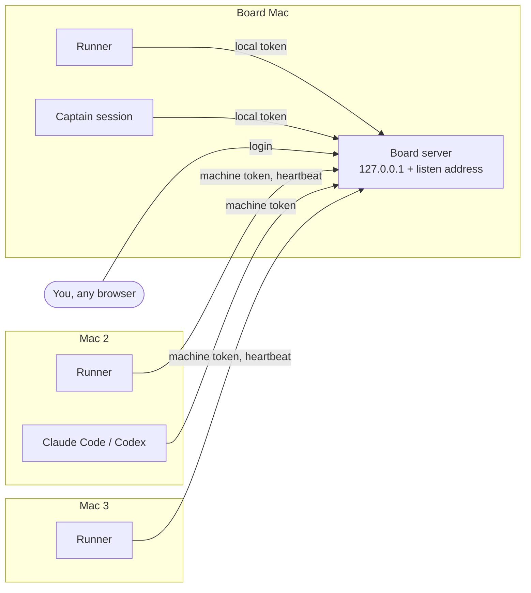

# One board, many Macs

By default the board serves only `127.0.0.1`: one Mac. A fleet is one board on one Mac plus any number of other Macs
whose agents and runners use it over the network. Every Mac has its own token; the board keeps track of each runner by
its heartbeat and gives back the cards of a runner that went quiet.



## Put the board on the network

On the board's Mac:

```bash
# this Mac's address on your private network, with a certificate and key for it (see TLS below)
./install.sh --listen 10.0.0.5 --tls-cert ~/board.pem --tls-key ~/board.key --ca-file ~/my-ca.pem
```

or set `server.listen` in `~/.dasks/data/config.json` and restart the board (`dasks-server --listen <addr>` and
`DASKS_LISTEN` do the same for one run). The board keeps serving `127.0.0.1` for this Mac and adds that one address.

With a listen address that is not loopback:

- The board refuses to start unless `auth.mode` is `enforce` (the default).
- Every request that comes in on that address needs a **machine token** or the human's board login. Only the page
  files, `/api/health` and the login itself are open. The installer's local token (`*`) is refused there, so a token
  copied off this Mac does not work from another one.
- `0.0.0.0` (every address) works, but name the hosts the browsers use in `server.extra_allowed_hosts`
  (`["10.0.0.5", "board.lan"]`): the board answers only to Host names it knows.

### TLS

Tokens, the passphrase and every card cross the network, so a listen address that is not loopback needs TLS: the board
refuses to start without it. Give it a certificate and key (PEM files) for the address or name the other Macs use:

```bash
./install.sh --listen 10.0.0.5 --tls-cert ~/board.pem --tls-key ~/board.key --ca-file ~/my-ca.pem
```

That sets `server.tls` (`{"cert": "<file>", "key": "<file>"}`) in `config.json`. With it every listener is HTTPS,
`127.0.0.1` included, and this Mac's clients use `https://127.0.0.1:<port>`; the certificate must name `127.0.0.1` too.
A certificate from your own CA (`mkcert`, or `openssl` as in `test/tls.test.ts`) needs that CA on every client:
`--ca-file F` stores its path in `~/.dasks/client.json` as `ca`, and every client (the `dasks` MCP and CLI, `dask`, the
merge gate, the runner, the captain) trusts it. `DASKS_CA_FILE` does the same for one process. A certificate from a
public CA needs no `--ca-file`. Node 22.19 or newer reads a CA file.

`server.allow_plain_http: true` (`./install.sh --allow-plain-http`) serves the listen address over plain HTTP anyway.
**Unsafe**: anyone on the network path can read the tokens and the passphrase and then write as any Mac or as you.
Only for a network you trust completely, such as a VPN between your own Macs that already encrypts.

## Add a Mac

On the board's Mac, issue one token per Mac and hand it over in a file (it is printed once):

```bash
dasks machine add mini > mini.token
dasks machine list
dasks machine revoke mini          # the board refuses its token from the next request
```

A machine token may write under any actor name ending in `@mini` (`runner@mini`, `claude-code@mini`, `captain@mini`)
and nothing else. Tokens are stored as hashes in the board's token store (docs/auth.md).

On the other Mac, get the kit as in the README (Install, path 2), then:

```bash
cd ~/dasks-kit && ./install.sh --join https://10.0.0.5:4747 --token-file ~/mini.token [--ca-file ~/my-ca.pem] [--with-runner]
```

`--join` checks the token with the board, then installs the client side only: the `dasks` MCP for Claude Code and
Codex, the `dasks`, `gb`, `dask`, `dasks-captain` and `dasks-captain-watch` CLIs, the skills and, with `--with-runner`,
the runner. No board, no passphrase, no token store. `~/.dasks/client.json` holds the board URL, the machine name (taken
from the token; `--machine <name>` only checks it) and the token. Delete the token file afterwards.

## The runner on a joined Mac

A joined Mac has no board config, so its runner reads `~/.dasks/runner.json`, with the same `runner` and `projects`
keys as the board's `config.json`. The projects list this Mac's own checkouts:

```json
{
  "runner": { "enabled": true, "max_parallel": 2 },
  "projects": [{ "id": "web", "repo": "~/code/web" }]
}
```

Cards build only for the projects listed there. Two runners never start cards with overlapping `touches:` in the same
project at once: the board refuses the second claim, whichever Mac it comes from.

## Heartbeats

Every runner posts a heartbeat on each look and once a minute between: its machine name, the harness CLIs on its PATH
(`claude`, `codex`), its slots (`max_parallel`), the cards it is working, the kit version with its commit
(`1.0.0+<commit>`) and, when its self-update is held, why ([runner.md](runner.md#staying-current)).

```bash
dasks fleet
```

```
mini             busy  last seen 2026-11-03 10:42:10  slots 2  claude,codex  web.t-form  v1.0.0+4f2a9c1d0e3b
build2           idle  last seen 2026-11-03 10:42:31  slots 1  claude  -  v1.0.0+0a1b2c3d4e5f  BEHIND  (update held: the kit checkout has local changes)
```

BEHIND: that Mac's kit commit is older than the board's own kit (an ancestor of it). The board page has the same list
under More → Fleet. A machine with no heartbeat for `fleet.dead_min` minutes (config,
default 15) is **quiet**: the board releases every card its runner (`runner@<machine>`) still holds in doing, with a note
on the card, so another Mac can take it. If another Mac took it, a runner that comes back finds the card on another run
and leaves it alone. Cards claimed by interactive sessions are never released this way.

| Route | What |
|---|---|
| `POST /api/fleet/heartbeat` | `{machine, harnesses, slots, cards, version, enabled, update?}` from `runner@<machine>` |
| `GET /api/fleet` | every machine: `last_seen`, `state` (`busy`, `idle`, `off`, `quiet`), cards, `behind` (true, false, or null when the board's kit does not know that commit); `kit` = the board's kit commit |
| `GET /api/whoami` | the actor and machine of the token you send |
