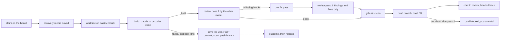

# The card runner

`dasks-runner` builds ready cards on this machine while you are away. It is off until you turn it on.

## What one run does



- **Claim.** The claim asks the board to refuse it while a card with overlapping `touches:` is being worked in the same
  repo, so two runners on different machines cannot start colliding cards. The board answers with a run id.
- **Recovery record.** Saved in `~/.dasks/runner/state.json` right after the claim. If the runner dies, the next start
  stops what it left running and gives the card back. A record goes away only after the board confirmed the release or
  the hand-back.
- **Success** means: the agent exited 0, was not stopped, ended with `RESULT: built …` and made commits after the
  branch tip it started from. Anything else is a failed attempt, and its work is saved for the next one (below).
- **Giving a card back:** the work is saved first (below), then the failed attempt's outcome is recorded for that run (it
  counts toward the board's retry cap), then the release names the run, so it can never release a later claim. Both
  notes say where the work is.
- **Limits** count from the card's start, across build, review and fix: never stopped before `timeout_min`. Past it, a
  run that is still writing is kept: new log output or a change in its worktree (an edit, a new file, a commit; checked
  every 30 s, without blocking the runner; a worktree that cannot be read in time counts as activity) counts. A run
  quiet for `idle_min` is stopped, and every run stops at `max_min` (12 h by default). The
  runner logs one line when it keeps a run past `timeout_min`. A stopped agent gets SIGTERM, then SIGKILL, and the
  worktree is removed only after every process it started is gone. `idle_min: 0` stops every run at `timeout_min`.
- **One nudge.** A Claude build that exits 0 without a `RESULT:` line usually ended its turn while waiting on something.
  The runner resumes that session once with a "continue" prompt, under the same limits and into the same log. Codex
  builds get no nudge: the runner starts `codex exec` without a session it could resume. `nudge: false` turns it off.
- **PR first.** The runner opens draft PRs and never merges them, so they can pile up. Before it starts cards it counts
  every open PR of each repo with `gh pr list` (four repos at a time, 20 s each at most, without holding up
  heartbeats or the card limits); a repo with more than `pr_limit` open PRs gets no new card until some
  merge or close. It logs one line when a repo goes over (and when it is back under), each held card is logged as
  skipped with the reason, and `dask runner status` lists the held repos. If `gh` is missing, not logged in or fails, the
  count is skipped and cards start without the PR limit (one log line).
- **Usage or rate limits:** that tool waits `backoff_min`; the attempt does not count.
- **Steps only you can do.** A build or fix prompt tells the agent to leave a login, signing, a paid purchase, a physical
  device or an approval undone and finish the rest. It never tries, fakes or works around the step, and it writes one line
  per step directly above its `RESULT:` line:

  ```
  HUMAN-STEP: <what is left undone> -- <why only you can do it>
  ```

  After a built run the runner writes each line as a card note (secrets redacted, cut to fit), lists the steps under "Not
  done" in the PR body and in the card's next steps, and the [daily summary](api.md#daily-summary) lists them. The card goes
  to review with its PR as usual; nothing marks a skipped step as done. If a required check needs the step, or nothing
  useful is left without it, the agent ends with `RESULT: stopped needs the human: <step>`. That is a failed attempt like any
  other: no PR, no note, the card goes back, and at `retry_cap` it is blocked on you with that reason. Only the lines
  directly above the last `RESULT:` line count.
- **gitleaks is required.** Without it the runner builds but never pushes, neither a finished branch nor saved work.
- It **never merges**, never pushes the default branch and never force-pushes.
- **Review.** At most 2 passes per PR, and passes an earlier attempt left on the board count. Pass 1 reviews the whole
  change. If a finding blocks, the builder gets one fix pass and pass 2 re-checks only those findings and regressions
  from the fixes. There is no pass 3.
- **What blocks.** A finding blocks only if it carries a repro: a `repro:` line right under it with the exact command,
  input or failing test and the wrong result it shows. A finding tagged `[security]`, `[data-loss]`, `[approval]` or
  `[money]` always blocks. Everything else is a follow-up: it is listed under `## Follow-ups` in the PR body and blocks
  nothing. The P level only orders the list; the line format is in the `review-loop` skill.
- **Not clean after pass 2.** The PR stays a draft (a ready PR from an earlier attempt goes back to draft), the open
  findings go on top of a new PR's body, the card gets a Spec block with those findings and you get a message on the
  card. It stays in review with its PR; nothing picks it up until you unblock it.
- **Review record.** Each pass is also stored on the board for the head it read, sent as the reviewing
  tool (`codex@<machine>`; the claim goes in as the build tool beside `runner@<machine>`)
  (`GET /api/tasks/<card>/review-runs`), which is what `dask captain-merge` checks ([captain.md](captain.md)). A clean
  pass 2 is the review of the fixed head.
- **Spec pass.** When a look starts no ready card, its free slots draft and review specs of open cards that have none
  (or an unreviewed draft): one harness drafts from a read-only view of the default branch, the other reviews, at most
  two full review passes and at most one narrow one, then the card is given back ready or draft with a note. No branch, no commit, no PR. `spec: false` turns
  it off. [specs.md](specs.md).
- **Heartbeat.** Every look, and every minute between, the runner tells the board it is alive and what it is working
  ([fleet.md](fleet.md)). A runner silent for `fleet.dead_min` loses its cards to the pool.
- **Order.** Cards you pushed start first, then bug fixes (cards of kind `bug`: `dasks new <app> "…" --kind bug`), then
  the rest by priority. `dask ready` and MCP `ready_tasks` list them in the same order.

## Stopped builds keep their work

A build that stops before it finishes (timeout, idle stop, `max_min`, a failed attempt, a usage limit, the runner being
stopped or dying) keeps its work, so the next attempt on any Mac continues from it instead of starting over.

**Saving, before the card goes back:**

1. Uncommitted changes become one commit, `<card>: wip: unfinished work saved by the runner (<reason>)`, built in a
   temporary index with no hooks. Files with secret-shaped names (`.env`, `.env.*`, `*.pem`, `*.key`, `*.p12`, `*.pfx`,
   `*.mobileprovision`, `id_rsa*`, `id_ed25519*`) stay out even when staged. Ignored files are not saved. No WIP commit
   is made when the worktree is not on the card branch, has unresolved conflicts, has more than 1000 changed paths or a
   file over 50 MiB; earlier commits are still saved and the note says why.
2. gitleaks scans `<default branch>..<tip>`, the WIP commit included, before anything leaves the Mac.
3. The card branch `dasks/<card>` is pushed to origin. Never the default branch, never with force.

| What happened | The note says | Where the work is |
|---|---|---|
| Clean scan, push worked | `Work saved: branch … on origin @ <sha>` | origin, and the local branch |
| gitleaks is not installed | `Work not pushed: gitleaks is not installed` | the local branch on this Mac, WIP commit included |
| gitleaks flagged something, or failed | `Work not pushed: gitleaks flagged …` | earlier commits on the local branch; the WIP commit on this Mac only, at `refs/dasks/kept/<card>/<sha>`, off the branch so the next run does not build on it |
| Push failed | `Work not pushed: git push failed (…)` | the local branch on this Mac |

A save that fails never holds up the hand-back: the card goes back with a note saying what was and was not saved. If the
board cannot be reached, the release retries with the same note. If the runner dies mid-save, the next start saves again.

**Continuing, before the next build.** The runner fetches `dasks/<card>` and starts from the first of these that fits:

- origin's branch, when this Mac's local branch holds nothing beyond it;
- this Mac's local branch, when it is ahead of origin's or origin has none (or the fetch failed);
- otherwise the default branch, as for a first run.

A saved branch counts only if it shares history with the default branch and adds something the default branch does not
have, so a branch whose work was already squash-merged is not picked up. One that conflicts with the default branch is
still used: the build merges. When a local branch and origin's have split, origin's wins, because every Mac can see it,
and the local tip is kept at `refs/dasks/kept/<card>/<sha>` (one log line says so). A build that continues gets a prompt
saying it is continuing and from where, and that `wip:` commits are unfinished saves.

To look at a kept ref: `git log refs/dasks/kept/<card>/<sha>`. To drop it: `git update-ref -d <ref>`.

## Turn it on

1. Give each project the checkout its cards build in (a git repo with a GitHub remote, `gh auth login` done), in
   `~/.dasks/data/config.json`:

   ```json
   "projects": [{ "id": "web", "name": "Website", "repo": "~/code/website" }]
   ```

2. Install the LaunchAgent and enable it:

   ```bash
   ./install.sh --with-runner
   ```

3. Watch it:

   ```bash
   dask runner status
   tail -f ~/.dasks/runs/runner.log
   ```

Try one look by hand first: `bin/dasks-runner --once`.

## Settings

`runner` in `config.json`, all optional:

| Key | Default | Meaning |
|---|---|---|
| `enabled` | `false` | off until you turn it on |
| `max_parallel` | `1` | cards built at the same time |
| `daily_cap` | `10` | cards started per local day (rate-limited starts are taken back) |
| `poll_minutes` | `10` | minutes between looks |
| `model` | `""` | Claude model for builds, fixes and Claude reviews (`--model`); empty = the `claude` CLI's default |
| `timeout_min` / `idle_min` / `max_min` | `180` / `150` / `720` | card limits, see above |
| `backoff_min` | `60` | wait after a usage or rate limit |
| `pr_limit` | `10` | a repo with more open PRs than this starts no new card; `0` turns it off |
| `nudge` | `true` | one "continue" to a Claude build that exited without a RESULT line |
| `spec` | `true` | when a look starts no ready card, free slots write specs for cards without a ready one ([specs.md](specs.md)) |
| `machine` | stored machine name | the runner's name on the board: `runner@<machine>` |
| `update` | on a joined Mac, off on the board's | between cards, update the kit checkout from its remote (below) |

On a Mac that joined a fleet these settings, and `projects` with this Mac's checkouts, live in `~/.dasks/runner.json`
([fleet.md](fleet.md)).

## Staying current

With `update` on (the default on a Mac that joined a fleet), the runner looks at the kit checkout between cards, never
while one runs: it fetches the checkout's remote and, when the remote's default branch moved, fast-forwards, runs
`npm ci --omit=dev` if `package-lock.json` changed, and restarts (launchd starts the new code; a runner started by hand
starts a copy of itself). It does not update, and says why in its log, in `dask runner status` and in its heartbeat
(`dasks fleet`, the Fleet page), when:

- the checkout has local changes, is on another branch, or has commits the remote does not (it never resets, stashes or
  forces anything of yours);
- the new kit needs a board schema newer than the board's (`/api/health` `schema.version`): update the board first;
- the fetch fails, or the kit folder is not a git clone.

The new dependencies are installed in a staging folder beside the kit first; only when that `npm ci` succeeds does the
checkout move and its `node_modules` get swapped, so a failed install (offline, say) leaves the runner as it was. The heartbeat carries the kit commit, so
`dasks fleet` marks a Mac whose kit is older than the board's as BEHIND. On the board's own Mac the board and the runner
share the kit, so `update` is off there: upgrade it as in [upgrade.md](upgrade.md).

## Stop it

```bash
launchctl bootout gui/$(id -u)/dev.dasks.runner
```

Running agents are stopped and their cards given back. Or set `runner.enabled` to `false`: it finishes the current card,
then idles. `./uninstall.sh` stops the runner and waits for its cards to be handed back before it stops the board.

## Read this first

`claude -p --permission-mode auto` and `codex exec --full-auto` run commands in the card's worktree with nobody
watching, using your account, your git and `gh` logins and your network. Turn the runner on only for repos and cards
you would let an agent work on alone.
