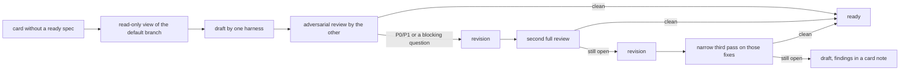

# Writing specs

The runner builds only cards whose spec is `ready` ([cards.md](cards.md) "Spec review"). A spec is ready only after a
reviewer of the other model family passed its current version, and the spec's author never builds the card. Dasks
writes those specs for you: the runner does it in its free slots, and `dask spec <card>` does it from your own session.

## The flow



1. **Read the real code.** The run fetches the project (`projects[].repo` in `config.json`) and opens a read-only view of
   the remote default branch (`origin/<default>`): a detached worktree under `~/.dasks/spec-views/` with every file
   write-protected, removed afterwards. Never your working tree, which may be dirty or on another branch. A project
   whose `repo` is a GitHub `owner/name` instead of a folder is cloned shallow with `gh` into `~/.dasks/cache/` (and
   fetched again next time).
2. **Draft.** One harness reads the card and the code and prints the whole spec (the method is the `spec-writer` skill):
   attack the premise, name only files and functions that exist, write scope and non-goals, acceptance tests that fail
   on today's code, 3-5 pass checks that can fail, done criteria, the finish line and scored open questions. The run
   stores it with `PUT /api/tasks/<card>/spec` under the drafter's name; a contract refusal (422) goes back to the
   drafter once.
3. **Review, adversarially.** The other harness gets the same read-only view and attacks the spec: wrong premise, files
   that do not exist, acceptance tests that would pass today, checks that cannot fail, a `done_when` nobody can check,
   unstated scope, hidden dependencies. Findings come back as `- [P0..P3] …`, open questions as
   `- [Q] often=N bad=N kind=K …`, and a `VERDICT:` line. The review is recorded with `review_spec` under the
   reviewer's own name (`claude@<machine>` or `codex@<machine>`): pass when there is no P0/P1 finding and no blocking
   question, fail otherwise.
4. **Two full passes, then at most one narrow pass.** On a fail the drafter
   gets the findings and writes the next version; the reviewer looks again in full. Still failing after pass 2: one more
   revision, and pass 3 checks only whether the pass-2 findings are fixed and the changed text broke nothing. Still open after that: the spec stays draft, the failing review stays on that
   version, and the findings go into a card note. A reviewed draft is not picked again until someone writes a new version.

Both harnesses run read-only: Codex in its read-only sandbox, Claude with only the built-in Read, Grep and Glob (`--tools`; no
shell, since even a git subcommand can write), allowed only under the view, with no MCP server and no user or project
settings, in `dontAsk` mode so any other read is refused. The file list and recent commits of the view are read ahead and put in
the prompt. A review counts only when the reviewer exited 0 and its last line is exactly `VERDICT: pass` or
`VERDICT: fail`; anything else records nothing and the spec stays draft. A spec run writes the
spec and notes on the board, nothing else: no branch, no commit, no push, no PR.

## Who drafts, who reviews, who builds

- The **drafter** is the harness that will not build the card: lane `claude` → Codex drafts and Claude reviews; lane
  `codex` → the reverse. So the builder only ever reviewed the spec it builds, and never wrote its answer key.
- A **draft someone already wrote** is reviewed by the family that did not write its Acceptance tests (whatever the lane),
  and the other tool revises it. A Mac without such a reviewer leaves it for one that has.
- The board refuses a review by the same model family as the answer key's author, and refuses the author as the
  card's builder, by tool identity: a session's draft (`human-claude-s1@box`) also bars `claude@box`. The runner never
  picks a ready card for the tool that wrote its spec.
- **One harness** on a Mac (or both mapped to one family by `config.json` `families`): the runner drafts with what it
  has and leaves the spec as draft, with a note that it needs a reviewer of the other family. It does not draft it again.

## The often × bad rule

Every open question gets two scores from 1 to 10: how often a builder would hit it, and how bad a wrong guess would be.

| Question | Blocks? |
|---|---|
| security, data loss, approval | always, whatever the score |
| any other, often × bad ≥ 30 | yes |
| a plain what / where / done question under 30 | no: it becomes "implementer decides (score N): …" in the card note, and the builder chooses |

A blocking question leaves the spec in draft like a P0/P1 finding.

## The finish line

Every new spec carries two header lines:

```text
done_when: the Save button stores the note and it is still there after a restart
done_at: pr        # or: live
```

- `done_when` is one line, at most 200 characters: what the user sees when the card is done, checkable by someone who
  did not build it.
- `done_at: pr`: the card is done when its PR merges. `done_at: live`: done only after someone checks the end state
  where it runs, after the merge (an installed app, a deployed service, a job).
- `PUT /spec` refuses (422) a card's first spec without both lines, and any spec whose previous version had them. An
  older spec without them is written as before, with a warning.
- A `live` card that would move to done without a check line moves to `review` on the lane `live-check` instead
  (Context filled in). It reaches done only with a result line `checked: <what, where> @ <commit>`:

  ```sh
  dask verify <card> --evidence "the board on the server shows the new column" --commit 1a2b3c4
  ```

## Running it

- **Runner:** `runner.spec` (default `true`, while the runner is enabled). When a look starts no ready card, its free
  slots take open cards in lanes `claude` / `codex` with no spec, or a draft nobody has reviewed yet, highest priority
  first. Not: cards blocked for Spec, claimed, waiting on dependencies, in a repo over `pr_limit`, past the daily cap
  (spec runs count toward it) or whose drafting tool is backing off after a usage limit. A spec run claims the card as
  `runner@<machine>` (so neither harness enters its claim history) and gives it back with the result as its note.
  A run that stores nothing and records no review counts as failed for that card text (title, body without notes,
  spec version); cards with failures go after the others, and after 2 failures on the same text the card waits until
  it changes.
- **Your session:** `dask spec <card>` drafts with the tool you are in and reviews with the other one, the same loop.
  `dask spec <card> --file F` stores your own draft (written with the `spec-writer` skill) as the first version and
  reviews it. It refuses a card someone holds and never claims it (a claim would bar you from writing its answer key).
  `--repo PATH|owner/name` overrides the project's repo; without one it reads the checkout you are in. Exit 0 = ready,
  3 = still draft (the note says why). Ctrl-C or SIGTERM stops the agent and removes the view; a view left by a run that
  was killed hard is removed by the next `dask spec`.
